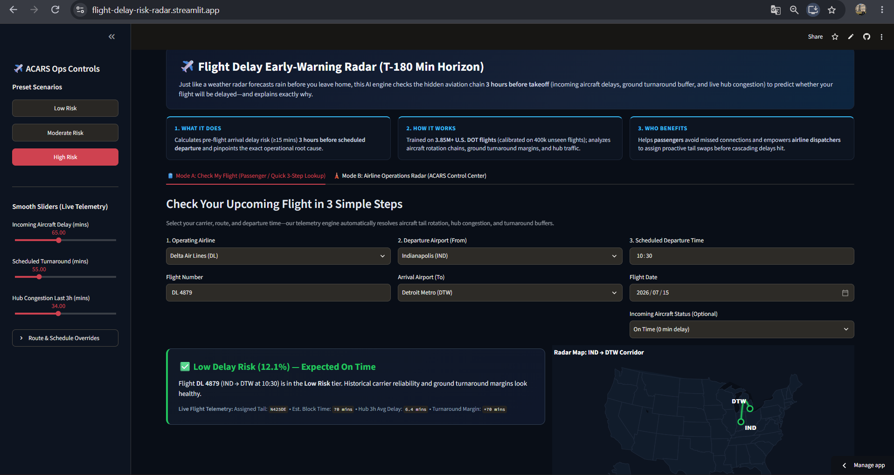
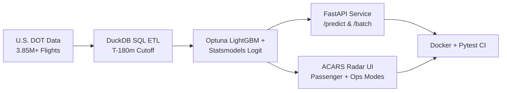
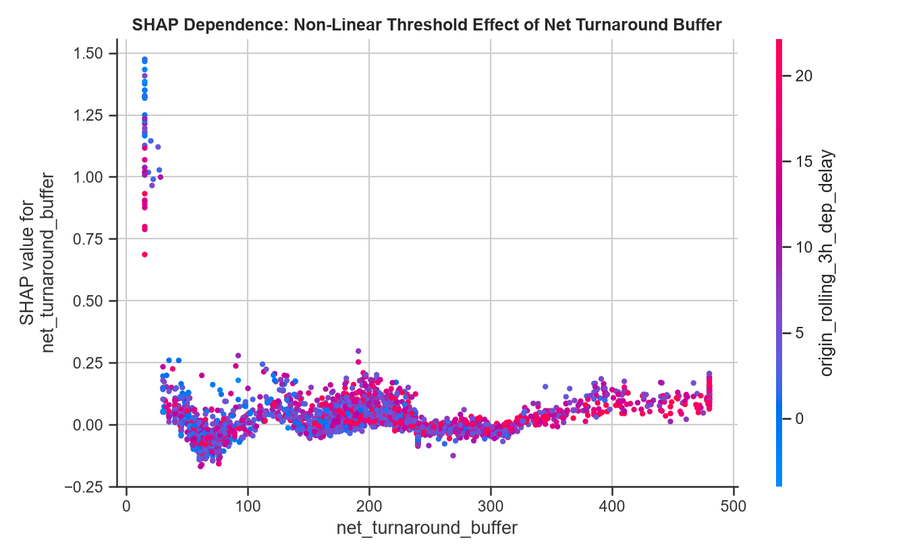
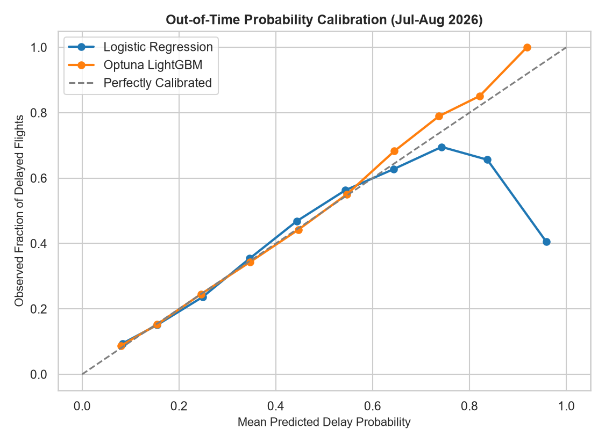

# ✈️ ACARS Flight Delay Risk Radar (T-180 Min Decision Engine)

[](https://github.com/eraycoban/flight-delay-risk-analytics/actions)
[](https://www.python.org/)
[](https://fastapi.tiangolo.com/)
[](https://streamlit.io/)
[](https://www.docker.com/)

**Predicting pre-flight arrival delays ($\ge 15$ min) 3 hours before takeoff across the 10 busiest U.S. hub airports—with zero future data leakage, real-time SHAP explanations, and prescriptive Tower Intervention simulation.**

> 🔗 **Live Interactive ACARS Radar:** [Launch Live App](https://flight-delay-risk-radar.streamlit.app/)  
> ⚡ **One-Command Local Launch:** `docker-compose up --build` → ACARS UI (`localhost:8501`) & API Docs (`localhost:8000/docs`)



---

## 🎯 Why This Project Stands Out (At a Glance)

Most flight delay models report artificial 95%+ accuracy because they leak post-departure telemetry. This system enforces a strict **T-180 minute operational cutoff** and ships as a tested, containerized ML product with two user modes (**Mode A: Passenger 3-Step Lookup** & **Mode B: Airline Operations Control Center**):

| Scale & Speed | Leak-Free Horizon | Out-of-Time Accuracy | Calibration Precision |
| :--- | :--- | :--- | :--- |
| **3.85M+ Flights** | **T-180 Minutes** | **0.7154 ROC-AUC** | **< 0.6% Error** |
| Processed in **6.54s** via DuckDB SQL | Strictly observable 3h before departure | Tested on **400k unseen** summer 2026 flights | Predicted risk matches actual delay rates |

---

## ⚙️ System Architecture



---

## 🚦 Operational Decision Matrix (Unseen Jul–Aug 2026, N = 400,000)

| Risk Tier | Flight Share | Predicted Risk | Actual Delay Rate | Dispatch Action |
| :--- | :---: | :---: | :---: | :--- |
| 🟢 **Low Risk (<20%)** | 34.8% | 14.4% | **14.3%** | Standard gate & crew buffer |
| 🟡 **Moderate Risk (20–35%)** | 35.4% | 26.5% | **26.4%** | Pre-stage turnaround crew & monitor inbound tail |
| 🔴 **High Risk (>35%)** | 29.8% | 49.7% | **50.3%** | Evaluate tail swap or proactive passenger rebooking |

---

## 🚀 Quickstart

### Option 1: Docker Compose (Recommended)
```bash
docker-compose up --build
```
- **ACARS Radar Dashboard:** `http://localhost:8501`
- **FastAPI Swagger Docs:** `http://localhost:8000/docs`

### Option 2: Local Python Environment
```bash
python -m venv .venv
source .venv/Scripts/activate   # macOS/Linux: source .venv/bin/activate
pip install -r requirements.txt
pytest -v                       # Run automated API & batch tests
uvicorn app.main:app --reload   # Start FastAPI backend
streamlit run streamlit_app.py  # Start ACARS Radar frontend
```

---

## 🔬 Deep-Dive Technical Findings (Click to Expand)

<details>
<summary><b>1. Benchmark Comparison: LightGBM vs. Logistic Regression</b></summary>
<br>

| Model | Val ROC-AUC | Val PR-AUC | Unseen OOT ROC-AUC | Unseen OOT PR-AUC | OOT Brier Score |
| :--- | :---: | :---: | :---: | :---: | :---: |
| **Logistic Regression (L2)** | 0.6985 | 0.4578 | 0.6924 | 0.4767 | 0.1874 |
| **Optuna LightGBM** | 0.7274 | 0.5151 | **0.7154** | **0.5281** | **0.1802** |

</details>

<details>
<summary><b>2. Econometric Drivers (Statsmodels Odds Ratios & VIF Diagnostics)</b></summary>
<br>

- **Incoming Aircraft Delay (`known_prev_aircraft_delay`):** +1 SD increases delay odds by **+33.5%** ($\text{OR} = 1.335$, $p < 0.001$).
- **3-Hour Hub Congestion (`origin_rolling_3h_delay_rate`):** +1 SD increases delay odds by **+28.3%** ($\text{OR} = 1.283$, $p < 0.001$).
- **Carrier-Hub History (`carrier_origin_hist_delay_rate`):** +1 SD increases delay odds by **+24.3%** ($\text{OR} = 1.243$, $p < 0.001$).
- **Early Morning Reset (`05:00–08:59`):** Reduces delay odds by **45.3%** ($\text{OR} = 0.547$, $p < 0.001$).

</details>

<details>
<summary><b>3. Post-Hoc Error Analysis & Visual Diagnostics</b></summary>
<br>

Analyzing missed delays (**False Negatives**) at T-180 min showed that **39.4%** stem from unobservable mechanical/crew disruptions (`carrier_delay`), while **32.0%** come from aircraft whose inbound leg landed inside the 3-hour cutoff window (`late_aircraft_delay`).

| SHAP Turnaround Threshold | Out-of-Time Calibration |
| :---: | :---: |
|  |  |

</details>

---

## 📁 Project Structure

```text
flight-delay-risk-analytics/
├── .github/workflows/ci.yml      # Automated Pytest CI pipeline
├── app/main.py                   # FastAPI V2 microservice (/predict, /predict/batch)
├── models/                       # Serialized LightGBM & Logistic pipelines
├── reports/figures/              # App preview, Calibration, SHAP & Odds Ratio plots
├── sql/                          # DuckDB schema & T-180m window feature queries
├── src/                          # ETL, EDA, Optuna training & OOT evaluation scripts
├── tests/test_api.py             # API & batch endpoint unit tests
├── Dockerfile & docker-compose.yml
├── streamlit_app.py              # Dual-mode ACARS Flight Delay Risk Radar UI
└── requirements.txt
```